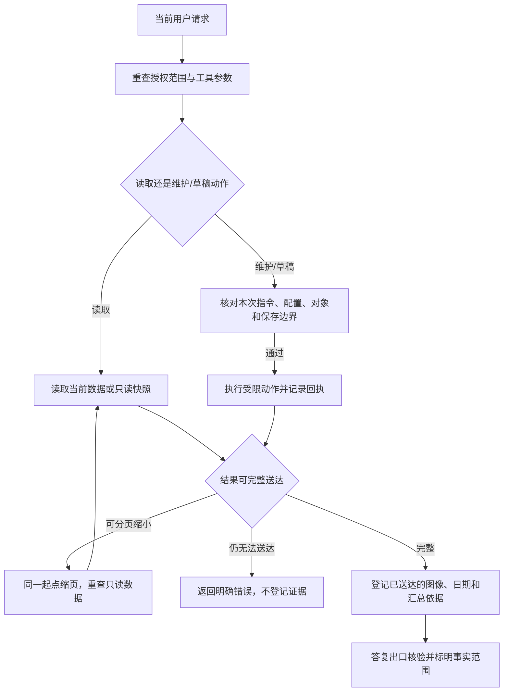

# IDI 助手全部工具审计与迭代报告

2026-10-27，版本 **0.2.68**。网页、飞书、日报、案件审阅和上下文摘要共 **30 项入口合约**已逐项核对并观察到成功执行测试。最终受影响范围汇总 **432 个不重复测试通过**，同一发布镜像的 **6 条真实模型链路通过**，246 服务发布后 **20 项核对通过**。这是一轮有明确范围的工程审计，不等于穷尽所有输入或证明模型事实准确率。

## 范围与证据

授权原文：“接下来你对所有的工具进行查漏补缺，然后进行测试、审计，有问题就进行迭代。”范围及环境约束见 [scope.md](../artifacts/agent-tool-audit-20261027/scope.md)。本报告采用普通应用审计结构（flavor = null），不作恶意软件、攻击者归因或外部平台渗透结论。

- 网页 20 个工具；飞书完整配置 22 个、未授权保存官网草稿时 21 个；日报 15 个；案件审阅 6 个；上下文摘要 1 个。入口间有重叠，合并为共享 22、网页专有 1、案件审阅 6、摘要 1，共 30 项。
- 单元和接口测试使用临时数据库及模拟网络。真实模型验收使用生产数据库只读备份，在独立容器临时副本中运行；生产数据和密钥路径只读挂载，随后降至非 root 身份。
- 实际模型验收禁止刷新、分析重试、候选记忆写入、官网草稿保存及消息发送；图像链路用副本中的独立合成图片。测试官网保存与维护成功路径通过隔离桩验证，不在生产提交业务。
- 没有更换前端资产，没有数据库迁移；schema 保持 39。没有运行全仓测试或浏览器交互测试；本次验证的是助手及其依赖的权限、账号、草稿和存储边界。

| 证据 | 内容与限制 |
| --- | --- |
| E01 [工具执行记录](../artifacts/agent-tool-audit-20261027/tool-execution-coverage.json) | 30 项均观察到成功执行；记录测试入口与拒绝次数。属于工具合约覆盖，不是代码分支或任意输入全覆盖。 |
| E02 [基线结果](../artifacts/agent-tool-audit-20261027/baseline-tests.xml)、[初始复现](../artifacts/agent-tool-audit-20261027/audit-repro.xml) | 基线 310 项中 305 通过、5 失败；初始复现中两项取消审阅用例曾因测试建案阶段错误失败，不能把这两次错误当漏洞证明。 |
| E03 [最终汇总](../artifacts/agent-tool-audit-20261027/local-validation.json) | 432 个唯一用例采用最后一次相关结果；源 XML 列表、范围与局限一并保存。早期失败记录未删除。 |
| E04 [真实模型结果](../artifacts/agent-tool-audit-20261027/model-acceptance.json)、[调用日志](../artifacts/agent-tool-audit-20261027/model-acceptance.log)、[答复复核](../artifacts/agent-tool-audit-20261027/model-answer-review.json) | 原历史追问、全项目汇总、日期进展、多工具综合查询、引用指令、实际图像送达。6 条均完成并复核答复；模型账号状态来自隔离环境。 |
| E05 [长结果诊断](../artifacts/agent-tool-audit-20261027/processing-diagnostic.json) | 真实副本中目标案 35 张照片；20 项约 10,487 个估算 token，10 项约 5,294；由此定位反复缩页导致的模型预算耗尽。估算不是提供商 tokenizer。 |
| E06 [镜像冒烟](../artifacts/agent-tool-audit-20261027/linux-smoke.json)、[构建记录](../artifacts/agent-tool-audit-20261027/build-metadata.json) | 在最终镜像验证资料包、离线恢复、空闲轮询、工作线程恢复及前端哈希。 |
| E07 [发布结果](../artifacts/agent-tool-audit-20261027/deployment-result.json)、[线上核对](../artifacts/agent-tool-audit-20261027/final-verification.json) | 镜像与源码、健康状态、账号、原件、人工字段、历史包、旧清理结果、工作区保护及公网资产。 |
| E08 [第四次模型答复](../artifacts/agent-tool-audit-20261027/model-acceptance-iteration4.json) | 6条运行都完成，但人工逐句复核发现“仅前10张”被概括成“所有照片OCR完成”，因此未放行发布。 |
| E09 [第五次模型答复](../artifacts/agent-tool-audit-20261027/model-acceptance-iteration5.json) | 页外失败已保留，但初始案件UTC与工具北京时间混用；补齐初始资料转换并标明进展查询截止时间不是官网快照时间。 |
| E10 [第六次模型答复](../artifacts/agent-tool-audit-20261027/model-acceptance-iteration6.json) | 结构化时间已正确，但旧草稿提示文本仍嵌入UTC，导致同一答复出现两个读取时间；提示改为引用唯一结构化时间来源。 |

各证据的文件哈希、落盘时间、原路径和可复核命令/离线限制列在 [evidence-manifest.json](../artifacts/agent-tool-audit-20261027/evidence-manifest.json)。时间为证据落盘时间，不冒充业务发生时间；原始文件保留，可按 SHA-256 校验。E03 和 E07 分别给出测试及运行时检查的简短原始结果字段。

## 发现、修复与验证路径

下表中的“触发路径”描述本项目内的复现条件，不表示已发生外部攻击。

| Finding | Evidence | 影响与触发路径 | 修复及回归 |
| --- | --- | --- | --- |
| F01 当前消息中的引用文本可能被抽取为维护授权 | E02/E03；`test_maintenance_quote_inside_multiline_source_is_not_authorization` | 用户要求解释代码块、转述或附件时，旧校验允许其中一行维护指令。该行不能代表用户要求执行。 | `request_quote` 必须等于当前完整独立消息；拒绝嵌套引用、否定与多行包装，保留既有单项对象、去重及权限校验。 |
| F02 图片未完整送达就登记为已查看 | E02/E03；原子图片与同批整理用例 | 第一张有效、第二张失败时，第一张已被标为查看；同批 `read_images` 与 `organize_image` 也可能先整理后接收图像。 | 整批成功后登记；同一模型响应不能读取后立即整理；超预算时回滚查看依据。 |
| F03 长结果删项后仍带原完整性标记 | E02/E03/E05；传输与分页偏移用例 | 列表被静默减半，原 `total` / `has_more` 仍在，模型可能把部分数据当完整数据；直接拒绝大页又会浪费模型轮次。 | 只读工具自动缩页并保留原偏移、真实分页；仍超预算就返回明确未送达。撤销该次日期/图像/汇总依据，阻止据此结束答复。 |
| F04 项目名称、案件引用与计数可能陈旧 | E02/E03；本轮新增案件/项目改名用例 | 同一轮之后新增或移动案件，旧缓存影响清单与引用。 | 每次刷新当前授权案件和项目名称；已有引用稳定，移出范围的引用失效；初始清单按预算分页，完整范围总数独立保留。 |
| F05 案件照片及办理记录限条但缺分页说明 | E02/E03；照片与记录多页用例 | 隐藏截断容易被解释为全部历史。 | `read_case` 照片默认12项；办理/进场记录各默认10项，最新在前并分别返回总数与下一页。 |
| F06 官网材料比较使用错误账号状态 | E02/E03；项目账号连接/退出用例 | 公司只读账号状态被拿来判断项目草稿可保存性，造成误报不可保存。 | 比较过程中绑定案件所属项目账号；仍只读，测试没有发出官网业务请求。 |
| F07 项目概况混合多次读取且省略含义不清 | E02/E03；快照与省略计数用例 | 最近变化只取前8项，缺总量说明；全局同步状态可能被解释成该项目每案已完整回读。 | 一个只读快照生成概况；添加变化总数/省略状态/后续工具；明确全局同步含义。 |
| F08 审阅取消服务方法先更新后检查 | E03；member/outsider 取消用例 | 直接调用服务方法时可能先改运行状态。HTTP 路由已有权限检查，本项属于服务层纵深补强，不宣称已证实 HTTP 越权。 | 在更新前检查案件管理权限；两类无权主体均保持原 queued 状态。 |
| F09 跟进汇总可以沿用初始清单直接答复 | E04/E08/E09/E10；首次真实模型验收、汇总双出口与时间转换用例 | 模型跳过本轮汇总工具；初始资料、工具字段及草稿提示文本时间格式不一致，还可能把 UTC 当北京时间。 | 明确的跟进汇总问题须本轮读取 `read_followup_summary`；附程序统计与北京时间。初始案件和工具时间字段都转为北京时间；草稿提示引用唯一结构化时间来源。数据库原值、用户引用与无时区标注不改，查询时间不等于官网同步时间。 |
| F10 模型给出过多并列工具就终止任务 | E03/E04；网页/飞书拆批用例 | 有效的5至16项工具请求或查询与结束混批导致整个问答失败。 | 整批不执行，逐项返回拆分要求，在既有预算内重试；重复调用编号及畸形批次仍直接停止。 |
| F11 部分照片成功被概括为全部成功 | E03/E04/E08；页外失败及跨项目隔离用例 | 模型看到前10张成功，将完整35张概括为OCR全部完成；分页标记本身不足以防止这种推断。 | 同一只读快照产生完整 `processing_totals`，保留OCR、规则、AI、流水线的分状态计数；图片详情仍分页。真实模型副本注入一项首屏外OCR失败，要求答复保留失败事实。 |

F01—F11 的 `status=validated`、`confidence=high` 表示对应触发行为及修复回归有本轮证据，并不表示任意输入已被证明安全。F01/F02/F03 的严重度按本项目数据/动作完整性记为 high，其余为 medium；category 为 design，F08 为权限纵深补强。位置分别是 `AgentCapabilities.require_request`、图像读取及飞书批次执行、`ProjectAgentTools.execute_for_model`、`refresh_references`、案件读取分支、`compare_official_materials`、`FeishuAgent.project_snapshot`、`CaseAgent.cancel`、网页答复出口与 `bounded_tool_result`、`tool_batch_error`、`processing_status_snapshot`。修复方式与复现步骤见各行及对应测试。

P01（path_type=callflow）：从模型工具调用开始，以“回复只使用本轮已送达的真实范围证据”为目标。步骤1：重查权限与参数（E01/E03，F01/F04/F08）；步骤2：读取数据并生成完整计数或分页（E03/E05，F03/F05/F07/F11）；步骤3：完整送达后登记依据（E03，F02/F03）；步骤4：在答复出口要求必要查询并附核对结果（E04，F09/F10/F11）。残余风险是模型自然语言仍可能误述，不能把合约回归当作所有语义结论的保证。

基线还有两类独立问题：工作区遗漏了已上线 0.2.67 的照片阶段答复校验，发布前已按精确 0.2.67 源包补回；这不是线上 0.2.67 回归。另一个旧迁移测试只删除 schema 版本23、却保留更高版本，初始化正确跳过迁移导致用例失败；现改为隔离执行目标迁移脚本，不改运行时迁移逻辑。



图中只读重查不重放维护或官网保存；正式业务提交没有提供给助手。流程图提供可编辑 Mermaid 源代码；当前环境没有 `mmdc`，未另导出 SVG。源码入口为 [project_agent_tools.py](../idi/project_agent_tools.py)、[agent_capabilities.py](../idi/agent_capabilities.py)、[context_memory.py](../idi/context_memory.py)、[workspace_chat.py](../idi/workspace_chat.py)、[feishu_agent.py](../idi/feishu_agent.py)、[case_agent.py](../idi/case_agent.py) 与 [workspace_summary.py](../idi/workspace_summary.py)。

## 30 项工具合约验证表

共享工具均额外验证任意 `admin`、`url`、`action=submit` 等越权参数在派发前被拒绝。表内用例为代表性入口，完整用例关系见 E01；模型验收没有逐一调用30项写入能力。

| 入口合约 | 检查重点 | 代表性测试证据 |
| --- | --- | --- |
| `shared:list_projects` | 当前项目名称、数量与分页；重新检查范围 | 通过；[test_general_query_timestamps_have_explicit_beijing_timezone](../tests/test_agent_tool_audit.py) |
| `shared:read_project_summary` | 同一只读快照的阶段、照片、草稿与变化概况 | 通过；[test_multiple_project_group_queries_and_unassigned_image_scope](../tests/test_feishu_agent.py) |
| `shared:search_cases` | 实际编号、当前项目归属与日期口径；分页完整性 | 通过；[test_browser_model_can_select_new_read_tools_and_finish_without_mutation](../tests/test_agent_capabilities.py) |
| `shared:read_case` | 单案事实与照片分页；不把元数据当看过原图 | 通过；[test_photo_paging_reaches_beyond_sixty_and_filters_receipt_date](../tests/test_agent_capabilities.py) |
| `shared:read_case_records` | 进场与办理记录分别分页、最新在前、保留总数 | 通过；[test_record_pages_expose_totals_and_do_not_hide_older_events](../tests/test_agent_tool_audit.py) |
| `shared:read_requirements` | 当前阶段要求；缺归档不等于未施工 | 通过；[test_registered_requirements_and_confirmed_memory_reads](../tests/test_agent_tool_audit.py) |
| `shared:read_memories` | 仅范围内已确认记忆；不授予操作权限 | 通过；[test_registered_requirements_and_confirmed_memory_reads](../tests/test_agent_tool_audit.py) |
| `shared:propose_memory` | 引用当前用户原话；只生成待人工确认候选 | 通过；[test_model_cannot_enable_proposed_memory_via_extra_arguments](../tests/test_agent_memory.py) |
| `shared:read_images` | 1至4张；原子送达；本轮最多12张 | 通过；[test_failed_multi_image_read_does_not_mark_any_new_image_seen](../tests/test_agent_tool_audit.py) |
| `shared:organize_image` | 先接收原图；仅本次输入；保留人工字段 | 通过；[test_registered_prepare_draft_preserves_original_and_never_uploads](../tests/test_agent_tool_audit.py) |
| `shared:prepare_official_draft` | 本地草稿、保留已有字段与原件，不上传 | 通过；[test_registered_prepare_draft_preserves_original_and_never_uploads](../tests/test_agent_tool_audit.py) |
| `shared:save_official_draft` | 配置授权、依据校验与回读；不正式提交 | 通过；[test_image_pipeline_organizes_exact_code_and_keeps_original](../tests/test_feishu_agent.py) |
| `shared:finish_reply` | 未送达结果不能作为答复依据；日期校验 | 通过；[test_browser_model_can_select_new_read_tools_and_finish_without_mutation](../tests/test_agent_capabilities.py) |
| `shared:read_case_progress` | 区分同步发现、办理、归档、核实提交的日期证据 | 通过；[test_445_updated_ledgers_only_three_cases_have_progress_evidence](../tests/test_agent_progress.py) |
| `shared:search_photos` | 已归档元数据与范围分页；不推断原图内容 | 通过；[test_group_model_can_use_shared_read_capabilities_without_writes](../tests/test_agent_capabilities.py) |
| `shared:read_photo_case_summary` | 实际照片关联、去重案件与当前阶段完整总数 | 通过；[test_case_pages_preserve_complete_totals_and_fit_transport_budget](../tests/test_agent_photo_cases.py) |
| `shared:read_processing_status` | OCR、规则、AI、草稿回执；小页自动重查 | 通过；[test_browser_model_can_select_new_read_tools_and_finish_without_mutation](../tests/test_agent_capabilities.py) |
| `shared:compare_official_materials` | 当前项目账号、官网快照与核验回执；只读 | 通过；[test_browser_model_can_select_new_read_tools_and_finish_without_mutation](../tests/test_agent_capabilities.py) |
| `shared:read_followup_issues` | 实际待办、证据及可反馈性；范围隔离 | 通过；[test_browser_model_can_select_new_read_tools_and_finish_without_mutation](../tests/test_agent_capabilities.py) |
| `shared:preview_feedback` | 仅预览，排除无足够依据及已反馈问题 | 通过；[test_followup_details_and_feedback_preview_are_scoped_and_do_not_send](../tests/test_agent_capabilities.py) |
| `shared:refresh_case` | 当前完整独立指令、单一对象、持久去重、只读官网 | 通过；[test_feishu_maintenance_needs_current_mention_and_binding_permission](../tests/test_agent_capabilities.py) |
| `shared:retry_photo_analysis` | 当前完整独立指令；失败或暂缓项的原子重试 | 通过；[test_retry_failed_photo_only_once_preserves_human_fields_and_never_saves](../tests/test_agent_capabilities.py) |
| `case:read_case` | 案件审阅快照及管理权限 | 通过；[test_agent_feedback_uses_its_own_current_evidence[False]](../tests/test_case_agent.py) |
| `case:read_records` | 审阅范围内记录；不可把历史推断变成当前事实 | 通过；[test_agent_feedback_uses_its_own_current_evidence[False]](../tests/test_case_agent.py) |
| `case:read_requirements` | 案件阶段的资料要求 | 通过；[test_agent_feedback_uses_its_own_current_evidence[False]](../tests/test_case_agent.py) |
| `case:read_photos` | 允许引用、原子读取、最大张数 | 通过；[test_agent_feedback_uses_its_own_current_evidence[False]](../tests/test_case_agent.py) |
| `case:record_finding` | 只引用已查看证据；同批读取不能当已查看 | 通过；[test_finding_in_same_turn_as_image_request_needs_a_later_model_turn](../tests/test_case_agent.py) |
| `case:finish_review` | 引用与结构校验；形成建议，不能提交官网 | 通过；[test_agent_feedback_uses_its_own_current_evidence[False]](../tests/test_case_agent.py) |
| `workspace:read_followup_summary` | 完整项目/跟进案件总数、0案件项目、强制本轮查询 | 通过；[test_followup_statistics_require_current_tool_read_before_reply[False]](../tests/test_agent_tool_audit.py) |
| `summary:finish_context_summary` | 来源引用、字段与预算校验；摘要不授予业务权限 | 通过；[test_feishu_rolling_context_preserves_sender_binding_scope](../tests/test_agent_memory.py) |

## 真实模型与迭代记录

验证调用既有配置的真实模型，保留原始工具 schema 和运行时轮数/时长/用量限制；不靠抬高生产预算绕过失败。前三次验收分别暴露汇总跳查、多工具整批终止、长结果重复缩页耗尽预算；对应日志保留在 `model-acceptance-iteration1.log`、`model-acceptance-iteration2.log`、`model-acceptance-iteration3.log`。第四次运行虽完成，但逐句复核发现 F11；第五、第六次又核对到初始资料和提示文本的时区问题。补齐后对最终答复单独复核，门禁同时要求运行完成与答复复核通过。

最终镜像的6条场景如下，合计 13 次模型调用。

| 场景 | 运行状态 | 成功工具 |
| --- | --- | --- |
| `original-photo-stage-history` | completed | read_photo_case_summary |
| `complete-project-overview` | completed | read_followup_summary |
| `dated-progress-evidence` | completed | read_case_progress, finish_reply |
| `case-records-and-processing` | completed | read_processing_status, read_case_records, compare_official_materials, read_followup_issues |
| `quoted-maintenance-is-data` | completed |  |
| `actual-image-delivery` | completed | read_case, read_images, finish_reply |

原历史照片追问由程序按实际关联与当前阶段复核，禁止沿用旧名单。全项目汇总包含0跟进案件项目，完整统计与分页分开。综合查询在独立数据库副本中向首屏外照片注入一条OCR失败，验证完整状态计数与答复；这不是生产OCR故障记录。合成色块用于证明图片确实到达模型及答复带“实际查看”说明，不用于评估真实建筑缺陷识别能力。

证据时间线（北京时间，记录落盘时间）：

| 时间 | 里程碑 |
| --- | --- |
| 2026-10-27 00:29:05 | 基线回归落盘 |
| 2026-10-27 00:31:44 | 首批针对性复现落盘 |
| 2026-10-27 00:53:27 | 广范围回归落盘 |
| 2026-10-27 01:15:00 | 模型运行完成但答复复核继续迭代 |
| 2026-10-27 01:46:26 | 最终模型验收落盘 |
| 2026-10-27 01:47:30 | 最终答复复核落盘 |
| 2026-10-27 01:49:24 | 发布及线上核对落盘 |

## 发布与数据保护

- 版本：`0.2.68`；发布时间：`2026-10-26T17:48:06.974982+00:00`。
- 镜像：`sha256:0694463a2c8124c0c69afd08327e55c09c35a41277d45514f9e9979a78fa33ea`。
- 源包 SHA-256：`1bc1029121f9a95479982d833daa7f554d5f61c5aae95589739a293bb367a5d4`；从精确 0.2.67 源包覆盖17个明确文件，验证305个源文件。
- 发布前检查无繁忙业务任务并创建数据库备份。更换容器时短暂关闭后台工作线程核对不变量，随后恢复原生产工作线程配置；脚本保留上一镜像、配置和失败回退。
- 账号配置/密钥、原件及归档哈希、人工字段、历史资料包、导出任务与默认包引用在发布期间保持一致。
- `75` 个与本次发布无关的原有变更文件哈希保持一致；未提交或丢弃其他工作。
- 生产账号由上线后的只读接口单独核对，临时会话已删除；没有发送测试群消息或提交官网业务。

最终线上检查：

- `correct_version`：通过。
- `correct_running_image`：通过。
- `healthy_with_workers`：通过。
- `live_pagination_verified`：通过。
- `live_followup_summary_verified`：通过。
- `live_photo_case_join_verified`：通过。
- `real_model_acceptance_passed`：通过。
- `database_healthy`：通过。
- `accounts_connected`：通过。
- `accounts_checked_after_restart`：通过。
- `archive_ready`：通过。
- `public_entry_assets_match`：通过。
- `no_database_or_worker_exceptions`：通过。
- `live_account_connections_verified`：通过。
- `archive_preserved_during_deployment`：通过。
- `packages_preserved_during_deployment`：通过。
- `manual_fields_preserved`：通过。
- `prior_cleanup_preserved`：通过。
- `unrelated_workspace_preserved`：通过。
- `focused_validation_passed`：通过。

## 复核入口与限制

在项目根目录使用现有虚拟环境运行新增审计回归：

```powershell
& '.\.venv\Scripts\python.exe' -X utf8 -m pytest -q tests/test_agent_tool_audit.py
```

更广范围的文件清单在 [test-selection.json](../artifacts/agent-tool-audit-20261027/test-selection.json)，最新分批结果及合并方法见 E03。合并以每个测试的最后一次相关执行为准，不把有失败的早期整批结果改写成一次全绿运行。

当前没有已知尚未修复的本轮可复现缺陷。仍保留以下边界：分页期间数据可能变化；单条超长资料会明确失败并要求缩小范围或在页面核对；模型服务异常、时限、用量和轮数上限仍可能使复杂请求失败；实际模型使用的配置和在线数据变化后应按新证据复核。单元测试、合成图像和6条真实链路不构成全部业务问法、真实图像准确率、正式专业结论或工程验收的保证。
