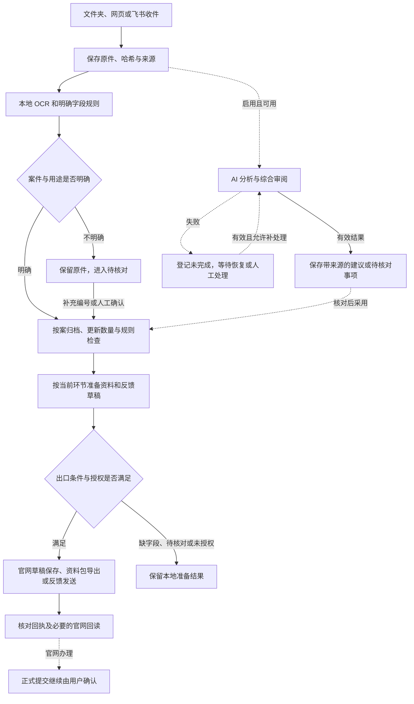

# 案件资料流程与 AI 不可用时的运行方案

目标：外部大模型不可用时，工作台仍能接收资料、保存原件、按明确规则归档、更新台账并支持人工办理；需要模型判断的工作保留待处理状态，恢复后按有效范围继续。

本文核对日期为 2026-10-17，对应 **0.2.25、数据库第 18 版**。统一模型故障状态、独立规则整理、本地草稿准备和受控照片补分析已经实现。原群草稿授权、正式提交权限及 08:00 同步／18:00 日报约定继续分别校验。第 11 节列出隔离测试覆盖和真实接入验证边界。

0.2.27 已增加独立的自动上传队列（数据库第 20 版）：当前环节照片可分批保存不完整草稿，完整资料生成工作台拟提交卡片；正式提交仍需人工核对。原群保存授权、原件校验与资料版本检查继续生效。

当前操作入口见 [V2 使用说明](workflow-v2.md)，模块边界见 [架构说明](architecture.md)。

## 1. 业务范围与职责

理赔受理是总清单，主要发现新案件并保留案件基础信息。查勘维修是主要工作区，负责照片收集、案件归属、用途分类、资料核对以及向官网、保司资料包、飞书反馈等出口分发。

| 执行者 | 负责的工作 | 完成依据 |
| --- | --- | --- |
| 程序与规则 | 收件、去重、原件校验、明确字段匹配、计数、资料模板检查、排队、回执记录 | 文件、数据库记录、明确规则和接口回执 |
| 外部大模型 | 可见内容分析、复杂照片理解、综合审阅、自然语言问答与摘要 | 实际读取的资料、有效结构化结果和来源引用 |
| 管理人员 | 核对歧义、补业务字段、处理例外、确认正式提交、核对结果未知的发送或写入 | 当前案件资料、业务授权及可追溯确认 |

本地 OCR 也使用识别模型，但在本机运行，与外部大模型的网络、密钥和额度分别管理。它输出的文字可能有误，不能把“OCR 成功”理解为“案件编号与照片用途已确认”。

必须分别保存以下事实：资料已接收、原件已归档、照片已归案、资料可用于报送、官网已保存、业务已提交。任何一个状态都不能替代其后的状态。完工照片、资料数量和 AI 意见不能直接推进案件阶段或认定验收通过。

## 2. 当前已经具备什么

| 环节 | 当前实现 | 运行边界 |
| --- | --- | --- |
| 官网更新 | 每天北京时间 08:00 增量检查、预算、断点接续及手动全量对账继续独立运行；运行栏显示真实成功时间 | 不调用模型，不提高已有频率或请求预算 |
| 文件夹与飞书收图 | 原件和来源先持久化，再排队本地 OCR；运行栏分列附件待处理及各入口错误 | 附件尚未下载时不声称原件已归档 |
| OCR 与归案 | 唯一编号或人工确认作为规则选材依据；新案件、编号和别名触发相关待归案照片重查 | 不重复 OCR，不用地址相似度取得自动报送资格，不改写已有人工归属 |
| 本地检查 | 规则结果与后台 AI 任务分别持久化；规则检查不等待模型 | 模型失败不消除此前有效 AI 问题，人工核对仍可继续 |
| 草稿与办理 | 新资料按明确规则准备本地草稿；已有授权群可保存查勘、修复成果草稿 | 保留人工字段与排除选材；跨来源选材转人工核对；正式提交仍由用户确认 |
| 日报 | 模型已知不可用或群内关闭 AI 时直接使用程序统计版 | 保留项目／日期去重、原窗口和负责人绑定；不再补发 AI 版 |
| 对话、审阅与记忆 | 共用模型故障状态与并发上限；原文、摘要、记忆及未完成记录保留 | 旧问答、整段 Agent 和有外部副作用的动作不自动重放 |
| 模型状态 | 分列配置、启用、接口响应、有效结构和各调用能力的最近结果 | 有效结构不等于识别准确；不会额外发送付费健康探测 |

以上来源与代码入口见第 12 节。现有记录不会因为本方案引入新的状态名称而被重新解释为成功。

## 3. 主流程

AI 分支与基础处理分别记录，不要求每张照片先通过模型才能归档。自动处理仅领取新到或明确变更的资料；升级不扫描历史照片重新报送。

各出口条件独立校验：能导出本地资料包不代表能保存官网；能保存官网草稿不代表能正式提交；形成反馈草稿不代表可以群发。

### 3.1 接收与归档

先记录来源事件，再保存和校验附件。只有原件实际落盘、内容可校验时，才能显示“已归档”；收到飞书图片消息但下载失败时，应显示“附件待下载”。相同文件复用内容档案，同时保留不同收件来源，不因重试重复增加原件。

文件夹继续使用稳定性扫描和原件保留机制。磁盘不足、数据库不可写或原件校验失败属于基础存储故障，应停止受影响的处理并提示管理员，不能作为一般 AI 故障忽略。服务完全停止期间不能接收或处理任何新任务。

### 3.2 识别、关联与分类

本地 OCR 负责读取明确文字；规则负责解释水印字段、匹配案件和识别已定义用途。完整官网编号唯一匹配时沿用既有优先级；项目、位置等文字差异保留提示，不自动修改案件台账。短编号及历史编号继续校验冲突。

用于自动选材的门槛是：**案件身份有唯一强证据，或归属已经人工确认；用途明确，且所需打卡角色等字段齐全。** 地址、相似问题、上下文或模型猜测只能提供候选，不能单独取得自动报送资格。规则依据仅使用本地 OCR、当前原消息的明确编号或人工确认；已有 `case_id` 本身不构成强证据。

未知编号、不唯一编号、未解决冲突、缺少用途、无法区分楼栋与入户门等情况保留具体原因。已经归案但用途未定的照片可以留在案件档案中，不进入不明确的官网栏位。

官网同步增加新案件或用户补充编号后，仅重新检查相关的待归案资料。不得全库重新分类、覆盖人工确认，或修改历史报送快照。

### 3.3 检查与人工核对

规则检查独立生成结果，包括原件完整性、必填字段、明确分类、模板要求和实际归档数量。图像亮度、分辨率和边缘指标只是核对线索，不能据此认定施工缺陷；“本机缺少照片”也不能表述为“负责人没有提交”。

AI 检查另行保存状态、原件版本、查看范围、来源和结论。模型失败时，已有规则检查仍有效；既有 AI 问题保持原状态，直到有效复查或人工处理。没有分析、只分析部分图片、截断、结构无效和资料已变更均不得显示为“检查通过”。

管理人员可以直接完成归案、分类、补字段和选材。手工确认后，等待中的旧模型任务必须重新校验版本，不能用迟到结果覆盖修改。

### 3.4 资料准备与分发

规则整理独立触发本地草稿准备，只追加本次符合门槛的照片，保留用户已有字段、选材和明确排除的附件。历史照片不会全部重新加入；业务日期、人员、费用、维修方式、原因和验收意见只能来自明确记录或人工填写。

| 出口 | AI 不可用时的行为 | 必须满足的条件 |
| --- | --- | --- |
| 本地案件档案 | 继续收集与整理；未确定信息显式保留 | 原件落盘、来源和归属依据可追溯 |
| 保司资料包 | 按既有模板和选材导出，保留缺项说明 | 固定选材、原件校验及版本快照；导出不等于已交付或业务完成 |
| 官网草稿 | 人工操作继续；规则自动准备本地草稿，已有授权范围内才允许自动保存 | 当前环节支持保存、明确选材、必填信息齐备、有效登录、写入模式开启、版本与权限仍有效 |
| 飞书反馈 | 已有有效人工确认或仍有效的具体证据可按既有策略处理 | 项目与负责人绑定、反馈证据、最新资料和发送回执；AI 故障本身不构成催补依据 |
| 正式提交 | 继续由用户核对并确认 | 当前官网阶段、预提交审核、原件与字段版本全部有效 |

规则自动保存仅覆盖原绑定项目、查勘与修复成果两个可保存环节，并保留 `save_drafts` 开关。文件夹、网页等其他来源只准备本地草稿；若当前草稿还包含本次群任务范围外的选材，则保留全部选择并停止自动保存，交由网页人工核对。缺字段的意图保留“待补字段”，补全后由人工保存。

有具体待核对问题影响选材、业务必填信息缺失、阶段不匹配、原件异常或审核失效时，暂停对应出口。单纯“AI 尚未分析”不自动否定已通过明确规则或人工核对的资料。

### 3.5 日报、问答和长期记忆

日报先由程序生成台账统计，AI 只补充说明。模型已知不可用时直接使用统计模板；首次普通模型尝试失败后仍能按发送窗口发出一次兜底简报。统计明确范围、截至时间、数据新鲜度和未完成数量，不用模型编造数字。

保留每天北京时间 18:00 的既有约定及负责人群绑定：当日允许的 1 小时恢复窗口内继续，过期记为错过；已经发送统计版后，不因 AI 恢复再发送第二份。发送失败与内容生成失败分开记录。

网页和群内自由问答不能用无来源的固定文本冒充答案。模型暂不可用时保留问题及历史，提示可通过看板查询，并提供明确重试入口。普通旧问答不在模型恢复后批量重答或补发。

长期记忆、摘要和原文继续保留。模型不可用时暂停新摘要和模型提议；人工查询、确认、纠正与删除现有记忆仍可使用。恢复时先校验来源与修订，不能通过摘要恢复已删除、过期或被纠正的结论。

## 4. 状态要按处理环节分别保存

下表展示不同步骤的业务状态。界面通过现有收件、独立规则结果、AI 任务、审核批次及发件记录组合显示，不用一个总状态替代各步骤事实。

| 状态维度 | 面向用户的状态示例 | 说明 |
| --- | --- | --- |
| 收件 | 消息已接收、附件待下载、原件已归档、收件失败 | 只描述文件是否取得并保存 |
| 归属与用途 | 待归案、已归案／用途待定、待核对、已确认 | 同时保留编号、规则或人工确认来源 |
| 规则检查 | 等待检查、已检查、有待办、检查失败 | 不包含 AI 内容结论 |
| AI 分析 | 未启用、排队、分析中、暂缓、完成、部分完成、待人工处理、资料已变更 | 记录依赖、原因、已查看范围与任务版本 |
| 本地准备 | 未准备、草稿已准备、待补字段、待确认选材 | 不表示已经写入任何外部系统 |
| 官网操作 | 待登录、待保存、已保存待回读、保存已核对、结果未知、已提交待回读、提交已核对 | 保存与正式提交各自保留回执 |
| 消息发送 | 未安排、排队、已送达、明确失败、结果未知、已取消、已过期 | 内容生成成功不能替代送达回执 |

例如同一张照片可以同时为“原件已归档、已归案、规则检查完成、AI 暂缓、本地草稿已准备”。不应因 AI 请求失败把整张照片显示成“处理失败”。等待时间到期也不等于业务失败或已确认通过。

## 5. 按故障来源决定哪些继续运行

以下状态可以同时出现，按各依赖分别处理。

| 故障 | 继续运行 | 暂停或等待 | 恢复条件与注意事项 |
| --- | --- | --- | --- |
| 外部大模型超时、限流或服务错误 | 收件、归档、本地 OCR、规则检查、台账更新、规则草稿、人工办理、统计版日报 | AI 分析、自然语言答复和新摘要 | 按第 6 节暂停新调用；恢复只补允许的有效任务 |
| 模型未配置、被主动停用或密钥无效 | 已启用的非 AI 流程 | 新模型调用 | 需配置或重新启用，不无限自动尝试，也不自动换服务商或模型 |
| 本地 OCR 不可用 | 接收并保存原件、人工关联与分类、台账更新 | 依赖文字识别的自动匹配 | 修复后重试未完成识别；不能把历史已确认资料全部重识别。已启用的 AI 可辅助分析，但不自动绕过归案门槛 |
| 官网未登录、登录过期或网络故障 | 本地收图、整理、导出；基于最近快照的查询 | 官网同步与写入 | 显示实际回读时间；重新登录后同步按检查点继续，写入先核对原结果 |
| 飞书接收或发送故障 | 文件夹／网页收图、已归档资料处理、官网同步 | 该渠道下载、收件或发送 | 按持久收件游标与消息 ID 补收；已过期日报不补发，发送未知先核对 |
| 公网入口或浏览器断开 | 若本机服务仍在运行，后台队列继续 | 当前页面交互 | 重新连接后查询原任务；同一提交请求不创建重复任务。公网不可达不等于本机服务已停机 |
| 本机服务停止或电脑关机 | 无后台处理；已持久化资料保留 | 所有调度与处理 | 启动后逐类恢复。文件夹补扫；飞书补收受权限、历史接口和附件可用性限制，不能承诺停机消息全部覆盖 |
| 磁盘不足、数据库不可写、原件缺失 | 未受影响的已有资料可读时仍可查看 | 受影响的收件、整理或报送 | 恢复存储与校验后再继续；未持久化的资料不得标为已收到或已完成 |
| 从备份恢复 | 核对恢复资料及重建浏览目录 | 自动接收、检查、群助手、反馈与同步依原恢复策略暂停 | 由管理人员确认启用；普通服务重启与备份恢复不能共用“全部自动继续”策略 |

故障可以同时发生。例如“AI 暂缓、官网待登录、飞书正常”应分别呈现，不能用一个总开关推导全部模块的状态。

## 6. 模型故障检测与重试规则

模型调用统一经过持久状态管理，区分“未配置／主动停用、待验证、响应有效、部分请求失败、暂缓、恢复试运行、需修正配置”。接口响应与有效结构分别记录；HTTP 200 不代表业务分析成功，更不代表识别准确。

| 原因 | 系统动作 | 是否自动补处理 |
| --- | --- | --- |
| 网络超时、连接错误、5xx | 记录失败，减少新请求；达到阈值后统一暂停该模型配置的新调用 | 仅允许无外部副作用、仍有效的后台分析任务 |
| 429／额度限制 | 优先遵守 `Retry-After`；没有有效恢复时间时使用退避 | 在额度允许后进行少量恢复试运行，不能让每张照片各自重试 |
| 401／403、模型不存在或配置错误 | 显示需检查密钥、权限或模型配置，停止自动尝试 | 配置修正并重新允许后才继续 |
| 输出截断、格式无效、引用不成立 | 本任务记为未完成，保留资料与过程 | 不机械重放同一请求；可缩小任务范围后新建有来源关联的任务，无法修复则转人工 |
| 用户停止、暂停功能、绑定或资料变更 | 取消旧任务或标为失效，丢弃迟到结果 | 不自动恢复用户已停止的任务；变更后按当前范围重新评估 |
| 已执行官网保存或消息发送但结果未知 | 保留本地操作记录与回执线索 | 禁止自动重放，先核对外部结果 |

0.2.25 已实现以下参数；它们是代码中的统一策略，界面只提供启停与明确重试入口：

- 同一模型配置在 5 分钟内连续出现 3 次可恢复接口失败，暂停新调用；首次等待 60 秒，重复失败按 120、240、300 秒递增。外部明确要求的更长等待时间优先。
- 恢复试运行只放行 1 个仍获允许的只读照片分析任务；成功后按正常并发上限处理，失败则继续等待。没有待处理任务时不周期性发送付费探测请求；交互请求可由用户在运行栏明确允许重新尝试，仍不能绕过服务端指定的等待时间。
- 一个未变资料版本的后台分析最多自动尝试 3 次，包含首次；达到上限转为待人工处理。服务重启不清零次数，不因每日跨日无限重跑。
- 共享模型并发上限 2，其中后台补分析最多占 1 个。一次候选查询最多 20 项，逐项校验、每次执行一项并继续领取后续；页面主动请求优先。实际吞吐取决于模型延迟，100 项积压测试不代表生产吞吐承诺。
- 当前每类任务的图片、轮数、时间和用量上限继续生效；统一管理不能把这些上限放大。主动停用的功能不会因为健康检测成功自动开启。

健康与重试信息按模型配置修订隔离，日志不得记录密钥。通用服务健康和某一任务特定格式失败分别统计，避免一张坏图片停止全部模型工作。

## 7. 恢复后具体补什么

恢复调度以“任务类型、对象与资料版本、规则版本、授权范围”识别同一工作。只领取未完成且允许补处理的项；领取和落地均校验版本。外部操作还需复用稳定操作标识和已有回执，不能把重跑整个 Agent 当作恢复手段。

| 积压类型 | 恢复动作 | 不得发生的行为 |
| --- | --- | --- |
| 附件未下载、文件夹新文件 | 按现有消息／文件记录继续接收，复用已保存附件 | 重复增加相同原件，丢失新来源 |
| 本地 OCR 未完成 | 对有效原件补识别；尊重人工确认 | 覆盖已确认字段，批量改动旧案件 |
| 新案件此前无法匹配 | 用新台账定向检查待归案编号 | 因地址相同随意归案或修改原有归属 |
| 后台图片 AI 分析 | 在用户已启用的范围内补当前版本；保存来源与范围 | 恢复时扫描所有历史图片或自动发送积压问题 |
| 用户主动发起的问答／案件综合审阅 | 保留原任务，提供重新发起入口；运行中被重启中断的不自动重放 | 批量重答旧对话、重发旧群回复 |
| 本地草稿未准备 | 按现有分类、人工字段与当前阶段重新计算可追加项 | 清空人工选材，补造业务字段 |
| 官网草稿保存失败或待登录 | 先回读当前案件、检查原回执，再重新验证本次保存意图；未经执行的有效意图才可按既有授权继续 | 无条件自动上传全部积压照片、重复保存未知操作、自动正式提交 |
| 群反馈或回复 | 明确未送达且仍有效时按原发送策略处理；未知送达先人工核对 | 因模型恢复补发历史建议、转向其他群或扩大收件人 |
| 当日日报 | 在原发送窗口内、尚未送达且绑定有效时继续；可使用统计版 | 跨日补报、已发统计版后再补发 AI 版 |
| 摘要与记忆 | 在下一次有效对话中按现有预算续作，校验来源及修订 | 删除原文、复活已删记忆、将旧推测确认为事实 |

后台补分析只更新内部结果。暂缓或重试后产生的发现明确标记为恢复分析，排除自动群反馈；人工可核对后按现有反馈流程处理。未新增任何渠道的自动发送授权。

## 8. 界面与操作入口

工作区顶部保留一行“运行状态”，分别显示存储、本地 OCR、AI、官网、收图入口和自动保存状态。点击“运行状态”进入“系统设置 → 后台任务 → 运行详情”，查看各入口错误、最近归档时间、待下载附件数、AI 积压数和最近分析记录；点击“自动保存”进入保存进度。状态栏只读，配置开关仍集中在系统设置。配置齐全只显示待验证；最近有效模型响应仍不能证明识别准确。

照片列表与详情显示原件、归案、规则检查、本地草稿和 AI 状态。恢复产生的建议可在“查看分析建议与范围”展开，不会自动覆盖人工字段。官网审核回执、未知写入和群消息送达记录继续使用原办理入口。

规则整理、明确资料准备草稿可分别开关；群助手新增独立“AI 分析”开关。只改变群内 AI 开关不改变原绑定修订、激活时间、日报窗口和草稿保存授权。收图、统计日报和反馈继续使用各自已有设置。

## 9. 遇到故障时怎么处理

1. 点击“运行状态”进入运行详情，先核对存储及附件，再看 OCR、模型、官网或收图入口的具体原因。AI 失败不代表原件没有收到。
2. 模型暂缓时继续归案、分类、补字段和人工办理；等待到期后，系统用一项有效只读照片任务试运行。若需主动恢复交互，点击“允许重新尝试”；服务端要求的等待时间仍须遵守。
3. 配置错误先在“模型设置”修正。单张资料达到上限或格式失败时，在“最近分析记录与重试”重新分析。重复点击复用同一个新任务，原失败记录保留；关闭的 AI 不会被重试按钮开启。
4. 本地 OCR 失败可点“重试未完成识别”，每批最多 100 项，仅处理有有效原件、无成功 OCR 记录且未确认的失败照片。用途或编号有歧义时直接打开照片人工核对。
5. 官网待登录时重新连接。尚未发出且仍有效的原群保存意图可继续；缺字段、跨来源选材、已失败或结果未知的保存需在案件页核对，不因模型恢复重新执行。
6. 群发送未知先检查原群及回执；旧问答和案件审阅未完成时由用户重新发起。统计日报已发送后不补 AI 版，过期日报不补发。

## 10. 交付与数据迁移

沿用现有队列、审核批次和发件回执，不新增与 08:00 同步、18:00 日报重复的定时任务。

| 交付部分 | 实现 | 保留边界 |
| --- | --- | --- |
| 基础流程独立 | 规则结果与 AI 队列分开；共享模型故障状态、限流和持久次数；统计日报直接降级 | 不把 AI 失败显示成收图失败，不误消除已有有效问题 |
| 规则接续准备 | 强编号或人工确认门槛、待归案定向重查、本次资料增量选材 | 人工字段与排除项保留；不扩大群、项目、阶段或来源权限 |
| 受控恢复 | 独立只读照片队列、版本复查、重复请求去重、运行状态和重试入口 | 不重放整段 Agent，不自动回传恢复建议或正式提交 |

第 18 版迁移为原照片建立历史索引，初始全部为未排队状态，不创建历史 AI 任务或官网保存意图。旧业务记录保留；模型状态按配置版本隔离。恢复备份默认关闭规则整理与草稿准备，取消未执行 AI 任务和保存意图，执行中或结果未知的保存保留人工核对状态。

升级前已保存数据库和源码副本；正式库副本迁移检查包含完整性、外键及全部旧业务表原有字段摘要，结果见本机验收目录 artifacts/ai-resilience。数据库副本只是迁移核验，不含重新扫描原件或真实接口写入测试。

## 11. 验收覆盖与限制

以下场景以独立数据目录、模拟模型响应和模拟官网／飞书回执验证。浏览器测试使用独立 8770 服务及临时档案；生产环境只做部署、只读状态和资料保留检查。本轮不通过真实模型断网、真实群发或官网测试写入来制造故障。

| 编号 | 验证内容与测试入口 | 实际覆盖与限制 |
| --- | --- | --- |
| A01 | 外部 AI 关闭；规则收图、OCR、确认与本地草稿 | 恢复专项、收件测试及浏览器路径覆盖；本地 OCR 文字在单元测试中注入，原件真实保存 |
| A02 | 连续 503、请求阻塞时收件及官网读取 | 共享暂停、独立导入、官网回读和双槽并发覆盖；未对真实供应商断网 |
| A03 | 400/401/403/404、429、无效 JSON、截断、空内容和工具格式错误 | 校验状态、调用次数及 Retry-After；人工重试也不能越过服务端等待 |
| A04 | 识别失败、未知／多个编号、用途与打卡角色不明 | 既有水印与打卡测试，加恢复专项强证据门槛；原件保留 |
| A05 | 地址候选与唯一完整编号优先级 | 水印回归与规则选材测试；地址相似不能自动取得上传资格 |
| A06 | 部分发现、已有 AI 问题及人工确认 | 案件审阅、项目跟进回归覆盖；恢复发现仅内部可见，自动反馈排除 |
| A07 | AI 关闭准备草稿，人工字段与排除项 | 恢复专项及浏览器覆盖，默认只追加本次照片，不猜业务字段 |
| A08 | 原群授权、撤销绑定、只读、登录及跨来源选材 | 恢复专项、群助手和官网保存回归；模拟接口断言仅 state=0，无正式提交 |
| A09 | 未知保存、回读失败和已有上传回执 | 保存／修复回归及恢复专项覆盖；已核实回执可复用，未知操作不重放 |
| A10 | 重复收件、发送超时及重启恢复 | 飞书收件与群助手原回归；未向真实群发送测试消息 |
| A11 | 已知模型不可用、恢复窗口及日期去重 | 统计版跳过模型、恢复后不补 AI 版；原过期与绑定测试继续保留 |
| A12 | 人工改照片／案件、配置和群范围变化、记忆删除 | 迟到结果丢弃，记忆／话题／对话回归覆盖 |
| A13 | 100 项积压、重建工作器、运行中任务恢复及重复重试 | 100 项各一次调用；重启保留已用次数，重复重试复用新任务；未声称实测生产吞吐 |
| A14 | 刷新、历史读取失败、断线请求去重 | 16 项浏览器场景与网页对话回归；未物理断开生产公网隧道 |
| A15 | 同步检查点、飞书补收限制及备份恢复 | 增量／收件／备份回归与新队列暂停测试；不保证停机消息全部补齐 |
| A16 | 磁盘写入异常与原件缺失／校验失败 | 注入 OSError 和缺失原件；无伪造归档或上传，未填满生产磁盘 |

本轮故障恢复专项 **39 项**、相关业务回归 **373 项**，合计 **412 项通过**；另有 **16 项浏览器测试通过**，运行栏覆盖 320、390、768、1024、1440 像素，前端类型检查与构建通过。未运行全量测试。正式库副本的 56 张旧业务表和原配置一致，73 张历史照片不重新排队，完整性及外键检查通过。运行日志及迁移核对结果保存在 artifacts/ai-resilience。成功响应、有效结构、图片识别准确性和真实业务完成分别判断；没有完成或结果未知的步骤继续明确保留。

## 12. 代码入口

| 模块 | 职责 |
| --- | --- |
| [model_runtime.py](../idi/model_runtime.py) | 共享模型状态、失败分类、Retry-After、单任务恢复试运行、并发与迟到响应校验 |
| [photo_ai.py](../idi/photo_ai.py) | 持久只读分析队列、三次上限、版本和原范围复核、人工重试去重 |
| [project_followup.py](../idi/project_followup.py) | 规则检查独立返回、当前有效 AI 结果投影、既有问题与恢复发现处理 |
| [photo_workflow.py](../idi/photo_workflow.py) | 明确规则归案、本地草稿、独立官网保存意图及原授权复查 |
| [draft_materials.py](../idi/draft_materials.py)、[platform.py](../idi/platform.py) | 本次资料追加、人工排除、范围保护及原件／草稿版本校验 |
| [review_batches.py](../idi/review_batches.py) | 上传回执复用、审核指纹、固定保存动作、未知结果与回读核对 |
| [feishu_agent.py](../idi/feishu_agent.py)、[project_agent_tools.py](../idi/project_agent_tools.py) | 独立群内 AI 开关、统计日报直接降级、原群权限与工具边界 |
| [operations.py](../idi/operations.py)、[RuntimeStatus.tsx](../frontend/src/RuntimeStatus.tsx) | 独立依赖状态、照片进度、规则开关及重试入口 |
| [018_resilient_workflow.sql](../idi/migrations/018_resilient_workflow.sql)、[cli.py](../idi/cli.py) | 增量迁移、定向重查索引和备份恢复暂停 |
| [test_resilient_workflow.py](../tests/test_resilient_workflow.py)、[resilience.spec.ts](../frontend/e2e/resilience.spec.ts) | 恢复机制专项及浏览器验证 |
